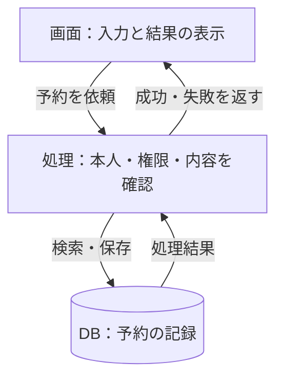
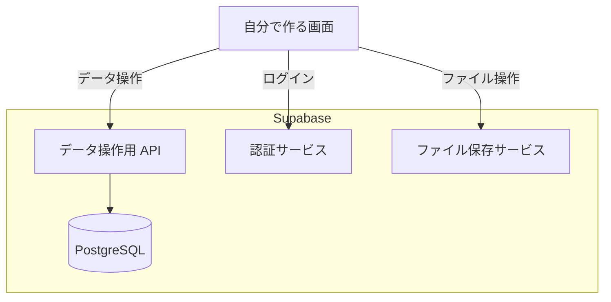

「Supabase を使えば、バックエンドはもう作らなくていい？」
「PostgreSQL は無料なのに、なぜ DB サービスには料金がかかる？」

この疑問は、製品の料金表だけを見ても解けません。**DB ソフトウェアと、それを含むサービスでは、比べている範囲が違う**からです。

PostgreSQL や MySQL は、データを管理するソフトウェア。Supabase は、PostgreSQL に加えて、認証やファイル保存などをまとめて提供するサービスです。

先に結論をまとめると、次の 3 点です。

- アプリは「画面・処理・保存」に分けて考えると、各部品の役割が見える。DB は主に保存とデータの整合性を担う。
- Supabase は PostgreSQL の代わりではなく、PostgreSQL に認証・API・ファイル保存などを組み合わせた BaaS である。
- BaaS を使っても、「誰に何を許すか」「予約をどう成立させるか」といったアプリ固有の設計は残る。

この記事は、画面は作れたけれど、認証・DB・サーバーをどう組み合わせるかで迷っている方に向けた入門です。予約アプリを例に、**どの役割をサービスに任せ、何を自分で設計するのか**を整理します。

対象は、複数の人がインターネット経由で使う Web アプリです。特定サービスの最安値を決める記事ではなく、サービスを選ぶ前の「地図」を持つための記事です。

サービスの機能と参照先は、2026 年 9 月 6 日時点で確認しています。

## 1. Web アプリの全体像は「画面・処理・保存」でつかむ

まず、予約アプリを思い浮かべてください。利用者が見るのは、空き状況や予約ボタンです。しかし、画面だけでは予約は成立しません。

「誰が予約するのか」「その時間は空いているか」を確かめ、予約の記録を残し、結果を画面へ返す必要があります。

図 1：画面から依頼を送り、処理を経て DB を読み書きし、結果を画面へ返す基本形です。通信経路や認証サービスの詳細は省略しています。

### フロントエンドとは、利用者との接点

フロントエンドは、画面の表示や操作を担う部分です。

予約日を選ぶ、フォームへ入力する、エラーを表示する、といった機能が該当します。Web アプリでは、ブラウザー上で動くコードがその代表です。

ただし、**画面でボタンを隠しただけでは、操作を禁止したことにはなりません。** 利用者から届く入力や操作の依頼は、画面の外側でも検証する必要があります。

### バックエンドとは、裏側で処理やデータを扱う部分

バックエンドは、利用者からの依頼を受け、必要な処理やデータ操作を行う側です。広い意味では、データベースもバックエンドを構成する要素に含まれます。

この記事では分かりやすくするため、バックエンドの中を「アプリの処理」と「DB」に分けています。

予約アプリなら、予約可能な期間を判定する、利用者の権限を確認する、保存の結果に応じて応答する、といった処理があります。

### API とは、処理を依頼するための窓口

API は、プログラム同士が機能やデータを利用するための取り決めです。Web API なら、画面側が「この内容で予約してほしい」と送り、処理側が結果を返す窓口として使えます。

API は、必ず独立したサーバーを 1 台用意するという意味ではありません。アプリの処理と同じプログラム内に設けることも、外部サービスが提供するものを使うこともあります。

ここまでの図は、**役割の分担であって、必要なサーバーの台数を表すものではない**のです。Web の要求と応答、アプリの処理と DB の関係は、MDN の解説でも確認できます。[MDN：クライアントとサーバーの概要](https://developer.mozilla.org/en-US/docs/Learn_web_development/Extensions/Server-side/First_steps/Client-Server_overview)

## 2. データベースの役割は「保存する」だけではない

データベースは、必要なデータを整理し、検索・更新できるように管理する仕組みです。

厳密には、管理されるデータの集まりを「データベース」、それを管理するソフトウェアを「データベース管理システム（DBMS）」と呼びます。PostgreSQL や MySQL は DBMS ですが、日常的な説明ではまとめて「DB」と呼ぶこともあります。

予約アプリでは、例えば次の情報を扱います。

- 利用者：誰が使っているか。
- 予約枠：いつ、何を予約できるか。
- 予約：誰が、どの枠を予約したか。

PostgreSQL や MySQL のようなリレーショナルデータベースでは、これらを表にあたる「テーブル」と、その関連として設計します。

### 消えては困る情報を残す

画面や処理プログラムのメモリーにだけ予約を持っていると、そのプログラムの終了や再起動で失われます。

そこで、後から取り出す必要のある情報を、永続化する構成の DB などへ保存します。保存と読み出しの設計があれば、画面を閉じた後や別の端末からでも、同じ予約を確認できます。

ただし、「DB に入れたから絶対に消えない」わけではありません。誤削除や障害に備えるバックアップと、戻せることの確認は別に必要です。

### 矛盾したデータが入るのを防ぐ

DB は単なる置き場ではありません。「同じ識別番号を重複させない」「存在しない利用者の予約を作らない」といったルールを、制約として設定できます。[PostgreSQL：データの制約](https://www.postgresql.org/docs/current/ddl-constraints.html)

例えば、定員 1 名の同じ予約枠に、2 人がほぼ同時に申し込んだらどうなるでしょうか。

2 人とも画面では「空きあり」を見ているかもしれません。そのため、画面の表示や「保存前に一度確認する処理」だけに頼らず、保存時にも重複を防ぐ必要があります。

予約枠の持ち方に応じて、一意制約やロックなどを使い、複数の処理が同時に走ってもルールを守れるように設計します。DB はそのための機能を提供しますが、何を禁止するかまでは自動で決めてくれません。

### 複数の変更を、ひとまとまりで扱う

「予約を作る」と「利用可能なチケットを 1 枚減らす」を、同じ DB 内で一体として成功・失敗させたい場合があります。このような処理に使うのがトランザクションです。[PostgreSQL：トランザクション](https://www.postgresql.org/docs/current/tutorial-transactions.html)

ただし、トランザクションを使うだけで同時予約の問題がすべて解決するわけではありません。また、外部サービスから送信済みのメールまで、DB の取り消しで戻せるわけでもありません。

**DB が提供する機能と、アプリとして守りたいルールを結び付けることが、設計の仕事です。**

## 3. 認証・ファイル保存・インフラは、どこに位置するのか

「画面・処理・保存」の基本形に、必要な機能を足していくと、アプリ全体が見えてきます。

### 認証と認可：誰かを確かめ、何を許すかを決める

認証は「あなたは誰か」を確認すること。認可は「あなたは何をしてよいか」を判断することです。

Google でログインできたとしても、その人にすべての予約の閲覧・削除を許してよいとは限りません。

一般利用者は自分の予約だけ、管理者は管理対象の予約を扱える。この区分を、画面だけでなく、処理側や DB 側で強制します。OWASP も、認証と認可を区別し、リクエストごとに権限を検証することを推奨しています。[OWASP：認可の設計](https://cheatsheetseries.owasp.org/cheatsheets/Authorization_Cheat_Sheet.html)

### ファイル保存：予約情報と画像は、分けて持つことがある

画像や PDF などは、ファイル保存サービスに置き、DB にはファイルの識別子、所有者、保存先などを記録する構成がよく使われます。

DB にファイルを格納することも可能です。どちらを選ぶかは、容量や配信方法、アクセス制御などによります。

Supabase も、ファイルを扱う Storage と、そのメタデータを持つ PostgreSQL を組み合わせています。なお、Supabase の DB バックアップには Storage のファイル本体は含まれません。「DB のバックアップがある」と「アプリの全データを復元できる」は別の話です。[Supabase：バックアップの範囲](https://supabase.com/docs/guides/platform/backups)

### インフラ：それらを動かし、利用者へ届ける土台

インフラは、コードを動かす計算資源、保存領域、ネットワークなどです。ホスティングは、画面や処理などを動かし、利用できる状態で提供することを指します。

ブラウザーからサーバーへ到達するためのドメイン名や DNS、通信を保護する HTTPS なども、公開する際に関わります。

クラウドやサーバーレスを使う場合も、裏側の計算機がなくなるわけではありません。どの範囲を自分で管理するかが変わります。

さらに必要なら、時間のかかる処理を後で実行する仕組みや、結果を一時保存するキャッシュ、エラーを把握する監視などを加えます。最初からすべてを別サービスとして導入する必要はありません。

## 4. 「予約する」を押した後、裏側では何が起きるのか

ここまでの役割を、1 回の操作でつなげてみます。ログインが済んでいる予約アプリの例です。

1. **画面が依頼を送る。** 選んだ予約枠などを Web API へ送ります。
2. **処理側が検証する。** 本人の確認情報、操作の権限、入力内容を確かめます。
3. **DB を使って予約を確定する。** 制約やトランザクションなどを使い、同時実行も考慮して保存します。
4. **処理結果を返す。** 成功したか、満席なのか、別のエラーなのかを画面側へ伝えます。
5. **画面が結果を表示する。** 確定した予約内容や、必要な次の操作を示します。

この流れには、通信が途中で切れる場合もあります。DB では保存が成功したのに、画面には成功の返事が届かないかもしれません。

そのとき「エラーだからもう一度保存する」とだけ実装すると、同じ予約を重複して作るおそれがあります。操作を識別して二重登録を防ぐ、結果を問い合わせ直せるようにする、といった設計が必要です。

つまり、**画面に成功と表示すること、DB に記録すること、その結果が利用者へ届くことは、それぞれ別の出来事**です。この区別ができると、不具合が起きた場所も考えやすくなります。

## 5. Supabase は、アプリのどこをまとめて提供するのか

Supabase は、PostgreSQL を中心に、認証、データ操作用の API、ファイル保存、リアルタイム通知、独自処理の実行環境などを組み合わせた BaaS です。

BaaS は Backend as a Service の略で、アプリの裏側に必要な機能を、サービスとして利用する考え方です。

代表的な構成の一つを、必要な部分だけ抜き出すと次のようになります。

図 2：画面が Supabase の各サービスを利用する構成例です。各操作には適切なアクセス制御が必要です。内部の連携や、独自のサーバー処理は省略しています。

重要なのは、Supabase は「PostgreSQL の代わり」ではなく、**PostgreSQL を含む部品セットである**という点です。すべての部品を使う必要はなく、DB だけ利用することもできます。[Supabase：公式アーキテクチャ](https://supabase.com/docs/guides/getting-started/architecture)

ブラウザーからサービスを利用する構成でも、DB の管理者パスワードをブラウザーへ渡すわけではありません。公開用の API とユーザーの認証情報を使い、許可された操作だけを通すようにします。

例えば Supabase では、DB の行ごとにアクセスを制御する RLS（Row Level Security）を利用できます。ただし、権限とポリシーの設定・検証が必要です。RLS を回避できる強い権限のキーを、画面側に置いてはいけません。[Supabase：行レベルセキュリティ](https://supabase.com/docs/guides/database/postgres/row-level-security)

予約枠をどう管理するか、誰を管理者にするか、キャンセルをいつまで認めるか。こうしたアプリ固有のルールは、BaaS を採用しても開発側で設計します。

## 6. 自前の DB・マネージド DB・BaaS は、何が違うのか

違いを理解する軸は、機能の数よりも「どこまで運用や部品の提供を任せるか」です。

### 自分で DB を運用する

PostgreSQL や MySQL を、自分の PC や借りたサーバーへ導入します。

設定の自由度がある一方で、更新、監視、バックアップ、障害対応などを自分たちで担います。学習用途や、運用できる体制・特別な要件がある場合の選択肢です。

### マネージド DB を使う

DB 基盤の運用をサービス会社に任せる方法です。Aiven は PostgreSQL や MySQL などのマネージドサービスを提供しています。[Aiven：マネージドサービスの例](https://aiven.io/free-tier)

DB の運用負担を抑えながら、認証やアプリの処理は自分たちで選んで組み合わせられます。任せられる保守・復旧の範囲は、契約やプランの確認が必要です。

### BaaS を使う

DB に加え、ログインやファイル保存などもまとめて利用します。部品の選定や接続にかかる作業を減らしやすい反面、独自の API や認証方式を深く利用すると、別サービスへ移す作業が増える場合があります。

「DB のデータを移せること」と「認証やファイルも含めて、アプリをそのまま移せること」は同じではありません。

この 3 分類は、厳密な製品の境界ではなく、責任分担を理解するための整理です。複数の領域を提供するサービスもあります。

### 何を任せられ、何が自分の仕事として残るのか

ここまでの違いを、責任分担で並べます。マネージド DB と BaaS は、事業者が運用するクラウド版を利用する場合の整理です。

| 比較する点 | 自分で DB を運用 | マネージド DB | BaaS |
|---|---|---|---|
| DB 基盤の保守 | 自分たちで行う | 契約範囲を事業者に任せる | 契約範囲を事業者に任せる |
| ログイン・ファイル保存 | 別の部品を選んで組み合わせる | 別の部品を選んで組み合わせる | 提供される部品を利用・設定できる |
| データ設計・権限・業務ルール | 自分たちで設計する | 自分たちで設計する | 自分たちで設計する |
| 復旧への備え | バックアップ構成から復元確認まで担う | 提供範囲を確かめ、不足分と復元確認を担う | DB・認証・ファイルを含む復旧範囲と手順を確認する |

「自分で作る」は、必ずしもゼロから実装するという意味ではありません。既存のライブラリや外部サービスも利用できます。BaaS の機能やバックアップの提供範囲は、製品・プランによって異なります。

**BaaS は、バックエンドの部品を任せる選択肢です。アプリのルールと責任まで、なくなるわけではありません。**

## 7. PostgreSQL や MySQL は無料なのに、なぜ料金がかかるのか

PostgreSQL は無料で利用でき、MySQL にも無料の Community Edition があります。[PostgreSQL：ライセンス](https://www.postgresql.org/about/licence/)、[MySQL：Community Edition](https://www.mysql.com/products/community/)

しかし、無料の DB ソフトを動かす場合でも、費用は次のように分かれます。

- **ソフトウェアの利用料**：無料のものを選べる。
- **動かす設備の費用**：計算資源、保存容量、通信、バックアップの保管など。
- **運用の費用**：更新、監視、障害対応、復元確認にかかる時間と人手。

自分の PC なら追加のクラウド利用料を払わずに試せますが、PC を停止すれば、その上の DB も利用できなくなります。

一方、サービスの無料枠は、設備や運用の一部も一定条件で提供するものです。無料枠を選ぶときは、容量だけでなく、休止条件、利用上限、復旧手段、上限到達時に停止するのか課金されるのかも確認しましょう。

**月額料金だけでなく、「自分たちが何を管理し続ける必要があるか」まで含めて比べると、選び方が変わります。**

## よくある疑問

### アプリには必ずデータベースが必要ですか？

必須ではありません。固定した内容を表示するだけのサイトや、入力値を計算して結果を返すだけの機能なら、DB を使わずに作れる場合があります。

複数の利用者の情報を共有したい、履歴を後から取り出したい、更新の整合性を守りたい、といった要件が、DB を検討する理由になります。

### SQL と PostgreSQL は、同じものですか？

違います。SQL は、データを検索・更新したり、テーブルを定義したりするための言語です。PostgreSQL は、その SQL を使って操作できる DBMS の一つです。MySQL も SQL を利用しますが、細かな機能や記法には違いがあります。[PostgreSQL：SQL 言語の入門](https://www.postgresql.org/docs/current/tutorial-sql.html)

### BaaS を使わないと、認証なども全部自作になりますか？

なりません。既存の認証ライブラリ、マネージド DB、ファイル保存サービスなどを組み合わせられます。

BaaS を選ばないことは、すべてをゼロから作ることではなく、部品の選定と連携を自分たちで行うことです。

## おわりに：製品名より先に、役割の地図を持つ

アプリの構成を考えるときは、最初に次の 5 つを書き出してみてください。

1. 利用者は、画面で何をするのか。
2. その操作で、どんな業務ルールを守るのか。
3. 何を記録し、誰と共有するのか。
4. 誰に、どの操作を許すのか。
5. 止まったり、間違って消したりしたとき、誰がどう戻すのか。

これが見えると、「無料だからこの DB」ではなく、「この役割を任せたいから、このサービス」という選び方ができます。

**データベースはアプリのすべてではありません。しかし、アプリが覚えておくべき情報と、その整合性を支える重要な部分です。**

その位置が分かれば、Supabase のような BaaS も、自分で動かす PostgreSQL も、同じ地図の上で比較できるようになります。

まずは作りたいアプリの操作を 1 つ選び、「画面 → 処理 → 保存」を書いてみてください。その横に、権限を確かめる場所と、失敗したときの戻し方を添える。サービス名を並べる前に、この小さな設計図を描くことが出発点です。
